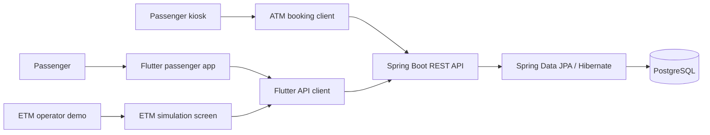

# SafarSetu

**Intelligent Public Transport Seat Availability Prediction System with ETM Simulation, Real-Time Occupancy Tracking, and Route-Based Passenger Analytics.**

SafarSetu is a Flutter passenger application with a Spring Boot REST API and PostgreSQL persistence. It demonstrates route search, bus details, route-position occupancy estimates, and ETM ticket/arrival simulations.

> **Prototype status:** Data currently represents deterministic or simulated records. The project has no verified operator feed, real timetable, fare/payment service, physical boarding evidence, or authenticated user/device accounts. The login screen is local demo navigation. Do not expose the unauthenticated API to public networks or use it for real passenger operations.

## Problem and objectives

Passengers often cannot tell whether a bus serves their route or how crowded it may be. SafarSetu explores how route, stop, and ticket-event data can present a useful seat-availability estimate while making the data source and uncertainty visible.

Project objectives:

- Search buses using ordered origin and destination stops.
- Show bus, route, seat capacity, and occupancy context without presenting unknown values as measured facts.
- Keep mock and API data-source selection explicit.
- Demonstrate ETM ticket and arrival event validation, route-stop boarding/alighting calculations, and capacity checks.
- Preserve simulation labels throughout API responses and UI notices.

## Features

### Passenger Flutter app

- Home screen with FROM/TO inputs and bus search.
- Bus results, bus details, ordered route stops, and seat-availability context.
- Recent journeys and locally stored favourite routes.
- Trips and profile navigation with local demo preferences.
- Explicit mock mode and opt-in API mode. API errors are surfaced for retry; API mode does not silently substitute mock results.

### Backend and ETM simulation

- Spring Boot endpoints for buses, routes, stops, search, bus details, location, and occupancy.
- Simulated ticket intake with idempotency, route-order validation, and passenger-capacity checks.
- Simulated arrival events with expected alighting calculations and refreshed occupancy.
- Separate ATM passenger kiosk for quantity-based simulation bookings.
- PostgreSQL persistence with source labels such as `SIMULATED` and explicit data-quality warnings.

Occupancy is a route-position calculation from ticket/reservation events, not a sensor count or an ML prediction. The API has no active scheduled-trip feed; the ETM simulator accepts a synthetic trip ID.

## Architecture



## Technology stack

- Flutter 3.47.2 / Dart 3.13.2 (or a compatible Flutter SDK).
- Java 21 target, Maven 3.6.3+, Spring Boot 4.1.1.
- PostgreSQL (the project has been exercised against PostgreSQL 18.6).
- JUnit 5, Mockito, Flutter `flutter_test`.

## Repository layout

```text
lib/                         Main Flutter passenger application
 test/                        Flutter unit and widget tests
 web/                         Flutter Web entry point
 backend/src/                 Spring Boot API, entities, services, tests
 backend/db/migration/        Reviewed SQL migration artifacts (manual; no runner)
 ATM/                         Separate Flutter Web passenger booking kiosk
 passenger_kiosk_app/         Kiosk project planning document
 ETM/                         ETM project materials
 docs/                        API, data, integration, and readiness documentation
```

## Prerequisites

Install Flutter/Dart, a Java 21 JDK, Maven, PostgreSQL, and Microsoft Edge for the Web run commands below. Confirm that your local PostgreSQL instance and database are the intended development target before starting the backend.

## PostgreSQL and backend setup

1. Create a local development database and a dedicated role using PostgreSQL administration tools. Set the role password with a secure local password prompt; do not put it in source or shell command history.
2. Start from [`backend/.env.example`](backend/.env.example) as a variable checklist. Spring Boot does **not** load `.env` files automatically.
3. In PowerShell, set the required variables in the same terminal that will run Maven. Replace the example URL and role with your local values:

```powershell
$env:DB_URL = 'jdbc:postgresql://localhost:5432/your_database'
$env:DB_USERNAME = 'your_local_role'
$secureDbPassword = Read-Host 'Local PostgreSQL password' -AsSecureString
$passwordPointer = [Runtime.InteropServices.Marshal]::SecureStringToBSTR($secureDbPassword)
try {
  $env:DB_PASSWORD = [Runtime.InteropServices.Marshal]::PtrToStringBSTR($passwordPointer)
  $env:DDL_AUTO = 'update'          # Local development only
  $env:SEED_DEMO_DATA = 'false'     # Set true only when you intend to add demo rows
  mvn spring-boot:run
} finally {
  [Runtime.InteropServices.Marshal]::ZeroFreeBSTR($passwordPointer)
  Remove-Variable secureDbPassword, passwordPointer
  Remove-Item Env:DB_PASSWORD -ErrorAction SilentlyContinue
}
```

`DB_URL`, `DB_USERNAME`, and `DB_PASSWORD` are required. Set `SEED_DEMO_DATA=false` to avoid insert-only demo seeding. `DDL_AUTO=update` is only for an isolated local development database; production uses the `prod` profile with Hibernate `validate` and TLS verification. The health endpoint reports application liveness only; successful bus/route queries are needed to confirm database readiness.

Check the backend:

```powershell
Invoke-RestMethod http://localhost:8080/api/health
mvn test
```

For more configuration, deployment boundaries, and data semantics, see [`backend/README.md`](backend/README.md).

## Flutter setup

From the repository root:

```powershell
flutter pub get
flutter analyze
flutter test
```

Run with deterministic local mock data:

```powershell
flutter run -d edge --dart-define=SAFARSETU_DATA_SOURCE=mock
```

Run against a started local backend:

```powershell
flutter run -d edge --dart-define=SAFARSETU_DATA_SOURCE=api --dart-define=SAFARSETU_API_BASE_URL=http://localhost:8080/api
```

The API base URL includes `/api`. Android emulators generally reach the host using `http://10.0.2.2:8080/api`; physical devices require a reachable LAN URL and an explicitly configured trusted CORS origin. See [`docs/FLUTTER_BACKEND_INTEGRATION.md`](docs/FLUTTER_BACKEND_INTEGRATION.md).

The separate passenger kiosk can be run from `ATM/` with `flutter pub get`, `flutter analyze`, `flutter test`, and `flutter run -d edge --dart-define=SAFARSETU_API_BASE_URL=http://localhost:8080/api`.

## ETM simulation workflow

In API mode, open **ETM simulation** from the Home screen. The screen loads active simulated buses and each bus’s ordered route stops, then accepts a synthetic trip ID, boarding/destination stops, and passenger count. A ticket response and arrival response are marked `SIMULATED`; arrival events report expected alighting and the resulting route-position occupancy. Capacity violations and invalid route order are rejected by the backend.

These are software simulation events. They are not proof of physical boarding, an operator-issued ticket, a real trip, or live vehicle occupancy. The API has no authentication, canonical trip schedule, ETM vendor integration, payment, or seat assignment.

## API overview

Base URL for local development: `http://localhost:8080/api`.

- `GET /health` — application liveness.
- `GET /stops`, `GET /routes`, `GET /routes/{routeId}/stops` — stop and route catalog.
- `GET /buses`, `GET /buses/search?fromStopId=...&toStopId=...` — bus listing and journey search.
- `GET /buses/{busId}` and `GET /buses/{busId}/occupancy` — bus details and route-position occupancy.
- `GET /buses/{busId}/location` — latest stored location record, if available.
- `POST /etm/tickets`, `POST /etm/simulated/arrivals` — simulation-only ETM events.
- `POST /atm/bookings` — quantity-based passenger kiosk reservation simulation.

See [`backend/API_CONTRACT.md`](backend/API_CONTRACT.md) and [`docs/ETM_API_CONTRACT.md`](docs/ETM_API_CONTRACT.md) for request/response details and limitations.

## Database migrations

The SQL files under `backend/db/migration/` are migration artifacts; Flyway/Liquibase is not configured and startup does not run them. Review each migration’s preconditions and data effects, take a verified backup, and apply migrations manually in order through the project’s approved development/deployment process. `V1`–`V6` and the `STEP13` scripts are not automatically applied by this repository. Do not use Hibernate `update` as a production migration strategy. Production startup validates schema instead of changing it.

## Screenshots

Screenshots are not included yet. Add reviewed application screenshots under `docs/screenshots/` and link them here when available; do not use mockups as evidence of working screens.

## Future improvements

- Authenticated passenger, operator, and device identities with authorization.
- Verified operator feeds, scheduled service runs, and vehicle location integration.
- PostgreSQL integration/concurrency tests using a disposable database.
- Reviewed, versioned migration automation and deployment runbooks.
- Validated fare, payment, cancellation, and seat-allocation workflows if supported by an authoritative operator.

## Contributors and license

Repository owner: [`kishantiwari-dev`](https://github.com/kishantiwari-dev). Add additional contributors as their project contributions are confirmed. No license is declared in this repository; reuse permissions have not been specified.